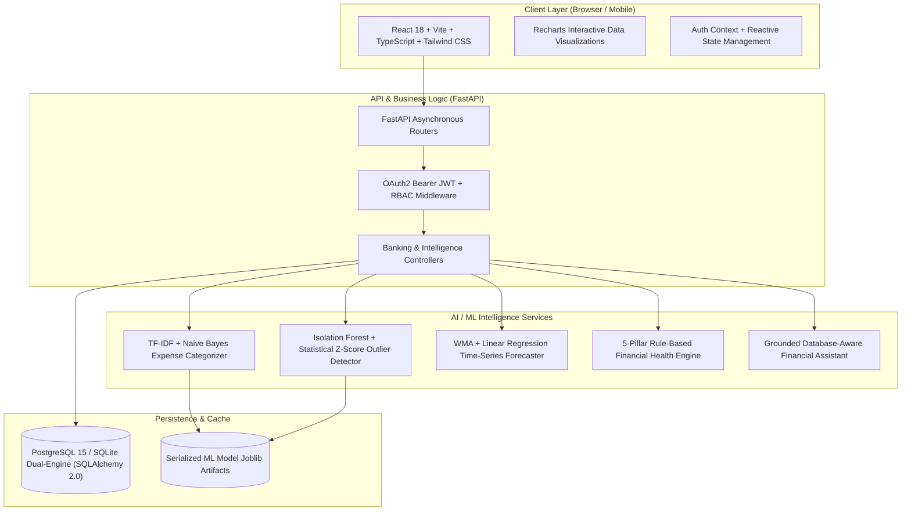
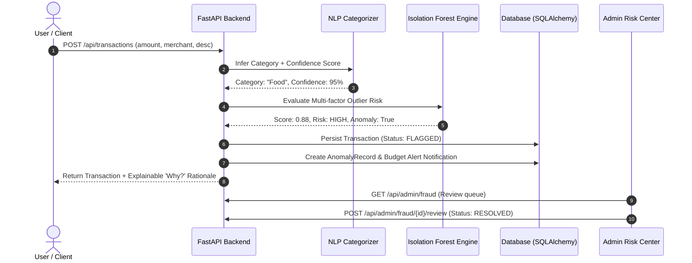

# 🏗️ SmartBank AI — System Architecture & Technical Design

## 1. System Overview

**SmartBank AI** is a multi-tier, explainable AI-powered FinTech platform engineered to turn everyday banking transactions into actionable financial intelligence. The system combines modern reactive frontend design, a high-throughput asynchronous REST API backend, lightweight and explainable Machine Learning engines, and a relational persistence layer.

---

## 2. Core Processing Pipeline

Every transaction submitted by a customer passes through the deterministic and explainable SmartBank AI Intelligence Pipeline:

---

## 3. Component Hierarchy

### Frontend Architecture (`frontend/src/`)
- **`layouts/`**: `DashboardLayout` (Collapsible responsive navigation, top header, user profile dropdown, active notification badges, compliance footer).
- **`pages/`**:
  - `LandingPage`: FinTech product landing page with hero CTA, feature spotlights, architecture preview, FAQ, and quick demo jump.
  - `DashboardPage`: Metric overview cards (Net Worth, Monthly Income, Spending, Savings Rate, Health Score), real-time charts, AI Insight Cards, and anomaly alerts.
  - `TransactionsPage`: Interactive transaction table with filtering, search, pagination, add/edit/delete modals, and "Why?" explainability popovers.
  - `BudgetsPage`: Category spending tracking with 4-tier alert status (Normal, Watch, Near Limit, Exceeded).
  - `GoalsPage`: Target savings milestones, progress bars, and dynamic monthly savings recommendations.
  - `ForecastPage`: Predictive expense analysis curves and category projection cards.
  - `FinancialHealthPage`: Transparent 5-pillar wellness score (0-100) with dynamic improvement recommendations.
  - `AssistantPage`: Conversational AI financial assistant with grounded database queries and predefined action prompts.
  - `KYCPage` & `CreditRiskPage`: Simulated onboarding OCR verification and educational credit-risk underwriting breakdown.
  - `admin/`: `AdminDashboardPage`, `FraudQueuePage`, `AdminKYCPage`, `AdminUsersPage`, and `AdminSystemPage`.

### Backend Architecture (`backend/app/`)
- **`api/`**: REST endpoints partitioned by domain (Auth, Accounts, Transactions, Budgets, Goals, Recurring, AI, KYC, Credit Risk, Reports, Notifications, Admin).
- **`ai/`**: Modular Python AI inference modules (`categorization.py`, `anomaly_detection.py`, `forecasting.py`, `financial_health.py`, `insights.py`, `assistant.py`).
- **`auth/`**: Password hashing with bcrypt, JWT token generation and validation, and role-based access checks (`CUSTOMER`, `ADMIN`, `SUPPORT_AGENT`).
- **`models/` & `schemas/`**: SQLAlchemy 2.0 ORM models and Pydantic v2 data contracts.
