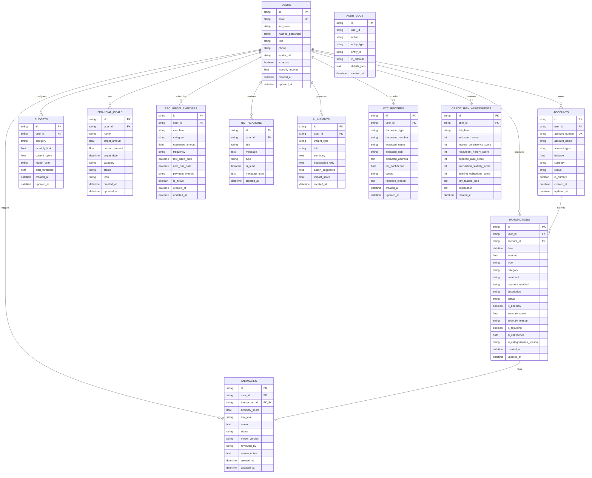

# 🗄️ SmartBank AI — Database Architecture & Entity Relationship Design

## 1. Database Overview

SmartBank AI uses a normalized relational database schema engineered with **SQLAlchemy 2.0 ORM** supporting both **PostgreSQL 15** (for containerized and production environments) and **SQLite** (for zero-dependency local development and testing).

- Primary keys: UUIDv4 strings for distributed uniqueness.
- Foreign keys: Enforced with cascading deletes for user lifecycle consistency.
- Timestamps: UTC-indexed `created_at` and `updated_at` on every table.
- Indexing: Strategic indexes on `user_id`, `account_id`, `category`, and `date` for millisecond dashboard query latency.

---

## 2. Entity Relationship Diagram (ERD)

---

## 3. Schema Data Constraints & Business Rules
1. **Accounts**: Balance cannot be updated without a corresponding Transaction or Transfer entry.
2. **Budgets**: `month_year` indexed format (`YYYY-MM`) enables longitudinal tracking across calendar months.
3. **Anomalies**: 1-to-1 unique relationship with `transactions.id`, ensuring each flagged transaction has an explicit administrative review state (`OPEN`, `UNDER_REVIEW`, `RESOLVED`, `FALSE_POSITIVE`).
4. **Audit Trail**: Administrative actions and user authentication events log IP address, entity ID, and change details to `audit_logs`.
